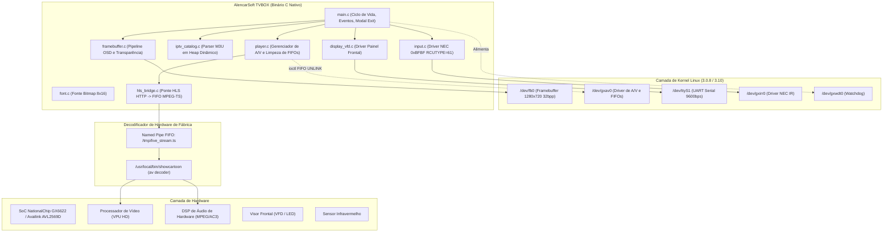

# Arquitetura Técnica do Sistema (AlencarSoft TVBOX)

O **AlencarSoft TVBOX** é uma solução de engenharia reversa e desenvolvimento de baixo nível desenvolvida em **C puro (C99)** para operar como um sistema IPTV autônomo, nativo e de alta performance em Set-Top Boxes e receptores DVB legados.

---

## 1. Visão Geral da Arquitetura

O sistema opera no modelo **Bare-Metal Linux**, dispensando interpretadores pesados (Python, Node.js), bibliotecas dinâmicas externas (`.so`) ou scripts shell intermediários (`.sh`).

---

## 2. Subsistemas Principais

### 2.1. Ponte Nativa HLS em C (`src/hls_bridge.c`)
Como os decodificadores de hardware das STBs legadas foram compilados sem suporte a rede (`--disable-network`), o aplicativo implementa uma ponte multithread interna em C puro:
1. **Thread Produtora (`hls_producer_thread`):** Conecta via sockets HTTP, lê a lista `.m3u8` e efetua download contínuo dos segmentos `.ts`.
2. **Ring Buffer Circular:** Buffer em RAM thread-safe de 4 MB protegido por mutex e variáveis de condição (`can_read`, `can_write`).
3. **Thread Alimentadora (`hls_feeder_thread`):** Transfere o fluxo MPEG-TS para uma FIFO nomeada (`/tmp/live_stream.ts`).
4. **Alimentação do Hardware:** O reprodutor da NationalChip lê a FIFO como se fosse um arquivo de disco local (`file:///tmp/live_stream.ts`), decodificando áudio e vídeo por hardware com aceleração completa.

### 2.2. Gerenciador de Áudio e Vídeo (`src/player.c`)
- **Desbloqueio de Canais do Kernel (`gxav_cleanup_audio`):** Varre os módulos de hardware (1 a 6) e pinos (0 a 7) de `/dev/gxav0` emitindo `GXAV_IOCTL_FIFO_UNLINK (0x1407)` antes de iniciar qualquer mídia. Isso evita o clássico erro `in_channel[1] is linked to c0707b9c` (erro 962) deixado pelo firmware de fábrica.
- **Ativação Conjunta de Áudio e Vídeo:** Executa `showcartoon` sem a flag `-p`, garantindo que o decodificador de áudio do DSP opere sincronizado com o VPU de vídeo.

### 2.3. Pipeline Gráfico OSD e Transparência (`src/framebuffer.c`)
- Resolução física `1280x720` em cores 32-bit ARGB.
- **Camada OSD vs Camada de Vídeo:**
  - Na grade de canais: `/dev/fb0` é preenchido com fundo sólido `COLOR_DARK_BG` (`0xFF12131A`), cobrindo o plano de vídeo.
  - Na reprodução: `/dev/fb0` é limpo com transparência total `0x00000000`, revelando o vídeo do hardware em tela cheia na TV.
  - Ao sair da reprodução: `/dev/fb0` é repintado imediatamente com a cor de fundo sólida, ocultando o último quadro do buffer de hardware.

### 2.4. Entrada e Navegação (`src/input.c`)
- Leitura direta de pacotes de 4 bytes de `/dev/gxirr0` sob protocolo NEC (`RCUTYPE=61`, endereço `0xBFBF`).
- **Navegação Inteligente:**
  - `KEY_ACTION_BACK` durante reprodução: Interrompe a mídia, limpa os processos e restaura a grade de canais de forma instantânea.
  - `KEY_ACTION_BACK` na grade de canais: Abre o diálogo modal `[SIM] [NAO]` para perguntar se o usuário deseja retornar ao sistema de fábrica.

### 2.5. Transição Segura para o Firmware de Fábrica
Ao confirmar a saída para o sistema original:
1. Para o reprodutor e a ponte HLS (`player_stop()`).
2. Limpa as FIFOs do kernel (`gxav_cleanup_audio()`).
3. Remonta a partição de fábrica (`mount /dev/mtdblock4 /app -t squashfs`).
4. Inicia o daemon original de satélite (`/app/dvbapp &`).
5. Encerra o binário do AlencarSoft TVBOX, devolvendo o controle completo à TV Box.
