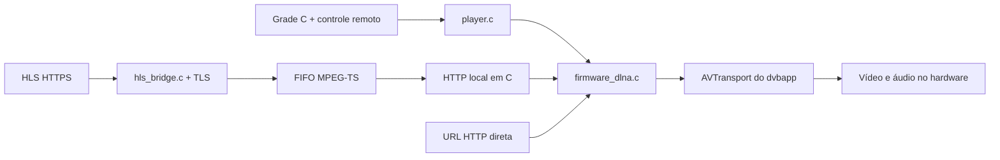

# Arquitetura atual do aplicativo C

O produto é um binário C estático para o S1009+ (C-SKY CK610). A interface
usa framebuffer, catálogo M3U, controle remoto e visor frontal. Para vídeo
e áudio no S1009+, a estratégia que tem evidência audiovisual usa o
**renderizador DLNA do firmware `dvbapp`**, portanto ele deve permanecer
ativo. Outros receptores podem precisar de backend próprio.

- `main.c`: ciclo de vida, catálogo, seleção, OSD transparente durante
  reprodução. No backend DLNA não mata `dvbapp`, não desmonta `/app` e não
  inicia outra instância na saída.
- `input.c`: abre somente nós IR existentes do tipo caractere e aceita
  teclado. Não substitui `/dev/gxirr0`; a concorrência com o IR do `dvbapp`
  ainda precisa de teste na TV.
- `hls_bridge.c` + `hls_playlist.c`: obtêm segmentos MPEG-TS de HLS compatível
  em C, usam ring buffer e FIFO `/tmp/live_stream.ts`.
- `hls_tls.c`: Mbed TLS, hostname/certificado obrigatórios, CA Mozilla
  embutida no binário com `.incbin`, entropia por `/dev/urandom`.
- `firmware_dlna.c`: enumera portas de escuta locais via `/proc/net/tcp`,
  procura serviço `AVTransport` na descrição, oferece HTTP loopback e envia
  SOAP `SetAVTransportURI`, `Play`, `Stop` com DIDL-Lite. SSDP é fallback.
- `player.c`: seleciona DLNA para C-SKY na compilação; MIPS ainda mantém
  `showcartoon`, sem confirmação audiovisual nesta pesquisa.

O teste de 25 segundos de ponte C + HTTP CGI de diagnóstico + DLNA produziu
imagem e som na TV. Uma versão integrada recebeu Play/GET, mas deu tela preta.
O teste de transporte integrado simulado e o build revisado passaram no CI
`40221895862`;
**ainda falta teste audiovisual do aplicativo integrado**.
Não interpretar `Play` aceito, bytes transmitidos ou processo vivo como
confirmação de imagem e áudio.

Limites atuais: HLS master, criptografia, fMP4, chunked e redirecionamentos
não têm suporte geral. HTTP direto é repassado ao player do firmware e ainda
não foi medido com canais reais. O servidor local atende um cliente por vez;
Stop, reconexão, troca de canal e sessão longa precisam de ensaio.
