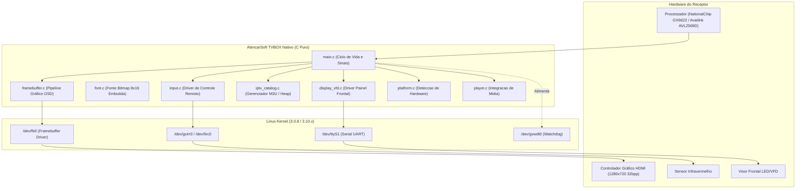

# Arquitetura Técnica do Sistema (AlencarSoftTVBOX-Clang)

O **AlencarSoftTVBOX-Clang** foi desenvolvido como uma solução nativa autônoma de alta performance escrita em C puro, projetada especificamente para operar em Set-Top Boxes, receptores DVB legados e TV Boxes com recursos limitados de CPU e memória RAM.

---

## 1. Princípios de Arquitetura

1. **Autonomia 100% Nativa (Zero Scripts Externos):**
   O aplicativo é um único arquivo binário ELF estático. Não depende de interpretadores (`python`, `node`), bibliotecas dinâmicas compartilhadas (`.so`), nem scripts wrapper em shell (`.sh`).
2. **Gerenciamento de Daemons de Fundo:**
   Ao ser iniciado, o próprio binário assume controle exclusivo dos recursos gráficos e de entrada, pausando os daemons legados do firmware de fábrica (`dvbapp`) via sinais POSIX (`SIGSTOP`), e restaurando-os (`SIGCONT`) de maneira transparente ao sair.
3. **Acesso Direto ao Hardware (Kernel Direct I/O):**
   - Renderização gráfica direta através de mapeamento de memória no Framebuffer (`/dev/fb0`).
   - Leitura de eventos de controle remoto via `/dev/gxirr0` e subsistema de controle.
   - Atualização do display frontal do receptor via `/dev/ttyS1` (VFD/LED).
4. **Alocação Dinâmica Eficiente em Heap:**
   Estruturas de dados grandes (catálogo de canais, categorias e buffers) são alocadas dinamicamente via `calloc()` no heap, evitando estouro de pilha (*stack overflow*) nas threads de tamanho reduzido do uClibc (64 KB).

---

## 2. Diagrama de Blocos do Sistema



---

## 3. Módulos Internos do Software

### 3.1 Ciclo de Vida e Gerenciamento de Processos (`src/main.c`)
- **`app_init()`**:
  - Configura tratadores de sinais para encerramento seguro (`SIGINT`, `SIGTERM`).
  - Configura `SIGTTOU` e `SIGTTIN` como `SIG_IGN` para evitar congelamento por controle de trabalho TTY.
  - Pausa o daemon satélite de fábrica (`killall -STOP dvbapp 2>/dev/null`).
  - Detecta o modelo de hardware em tempo de execução via análise de `/etc/gx.cfg` e `/proc/cpuinfo`.
  - Inicializa o visor frontal, o Framebuffer, o driver de entrada e carrega o catálogo inicial de canais.
- **Loop Principal de Renderização**:
  - Roda a uma cadência fixa de aproximadamente 33 quadros por segundo (`usleep(30000)`), garantindo suavidade de animação com consumo inferior a 2% de CPU.
  - Alimenta periodicamente o watchdog de hardware para evitar reinicializações automáticas da box.
- **`app_cleanup()`**:
  - Libera toda a memória alocada dinamicamente no heap (`catalog_free`).
  - Desmapeia a memória do Framebuffer (`munmap`).
  - Envia texto informativo de saída para o visor frontal (`"PRONTO"`).
  - Restaura o daemon nativo do receptor (`killall -CONT dvbapp 2>/dev/null`), devolvendo o aparelho ao estado normal.

### 3.2 Subsistema Gráfico e OSD (`src/framebuffer.c` e `src/font.c`)
- **Motor de Desenho Sem Dependências:**
  - Desenhador de primitivas geométricas em software puro: retângulos preenchidos (`fb_draw_rect`), caixas com bordas decoradas, sombras e linhas divisórias.
  - Renderizador de texto bitmap utilizando fonte embutida `8x16` monocromática (`src/font.c`), garantindo que o aplicativo renderize caracteres com contraste perfeito mesmo sem biblioteca externa tipo FreeType.
- **Grid de Navegação de Canais:**
  - 9 canais por página organizados verticalmente com numeração, nome e indicador visual de seleção ativa (fundo azul destacado `#1E50A0` e cursor indicador `>`).
  - **Identificação Automática de Qualidade:** O motor analisa os atributos do canal e exibe as tags de alta definição posicionadas **após** o nome do canal:
    - `[1080p FULL HD]` em verde claro para transmissões Full HD.
    - `[720p HD]` em ciano para transmissões padrão HD.
  - Abas superiores de categorias (Todos, Abertos, Esportes, Filmes e Séries, Notícias, Documentários, Infantis, Variedades).

### 3.3 Catálogo Dinâmico em Heap (`src/iptv_catalog.c`)
- Parser ultra-rápido de listas no formato `.m3u` / `.m3u8` com suporte a tags `#EXTINF` e `#EXTGRP`.
- Gerenciamento dinâmico de memória via ponteiros expansíveis com `calloc()` e `realloc()`, comportando até 2000 canais simultâneos em menos de 1 MB de memória RAM.
- Suporte a atualização dinâmica de grade em tempo real através da tecla **MENU** do controle remoto.

### 3.4 Entrada de Controle Remoto (`src/input.c`)
- Driver não-bloqueante lendo diretamente de `/dev/gxirr0` e `/dev/lirc0`.
- Mapeamento direto de códigos IR para eventos de aplicativo:
  - `KEY_NAV_UP` / `KEY_NAV_DOWN`: Navegação entre canais da grade.
  - `KEY_NAV_LEFT` / `KEY_NAV_RIGHT`: Alternância rápida entre categorias e páginas.
  - `KEY_ACTION_OK`: Seleção e reprodução imediata do canal.
  - `KEY_ACTION_BACK` / `KEY_EXIT_APP`: Retorno de menu e saída do aplicativo.
  - `KEY_ACTION_MENU`: Atualização de catálogo via web.

---

## 4. Pipeline de CI/CD Multi-Arquitetura (`.github/workflows/build_tvbox.yml`)

O repositório possui uma pipeline automatizada no GitHub Actions que compila para todas as arquiteturas suportadas a cada `push` na branch `main`:

```text
Commit Push -> GitHub Actions (Ubuntu)
                  ├── Job 1: Build C-SKY (Azamerica S1009+)
                  │          Toolchain: NationalChip GCC 4.5.1 uClibc (Linux 3.0.8)
                  │          Flags: -static -std=gnu99 -O2 -Iinclude -D_GNU_SOURCE
                  │          Artefatos: alencarsoft_tvbox_csky, mini_test
                  │
                  ├── Job 2: Build MIPS (Cinebox, Duosat, Tuning)
                  │          Toolchains: mips-linux-gnu-gcc (BE) / mipsel-linux-gnu-gcc (LE)
                  │          Flags: -static -O2 -Iinclude -D_GNU_SOURCE
                  │          Artefatos: alencarsoft_tvbox_mips_be, alencarsoft_tvbox_mips_le
                  │
                  └── Job 3: Publicação Automática de Release
                             Gera tags v1.0.x-native com binários compilados para download direto.
```
